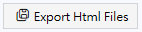

Generate the Website
--------------------

After editing all the documents, simply click the "Generate HTML Files" button, and all *_zh.htm and *_en.htm files will be generated in the specified directory.

The user can continue editing these .htm and .css files to add more detailed styles and even add JavaScript code. When publishing this website, you don't need docs.tocx or .md files.

Publish to GitHub Pages
-----------------------

If you want to create online document for a GitHub repository using this software, create a subdirectory named **docs** in that repository,
and upload all the generated website files to that directory, Then, under **Settings** in the repository, select the **Pages** item,
and in **Build and Deployment**, choose the **Branch** of the webpage source as **main / docs**, and click the **Save** button tokeep this setting.
As shown below, the website will appear in the URL https:// *yourname*.github.io/ *repository_name*/.

