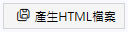
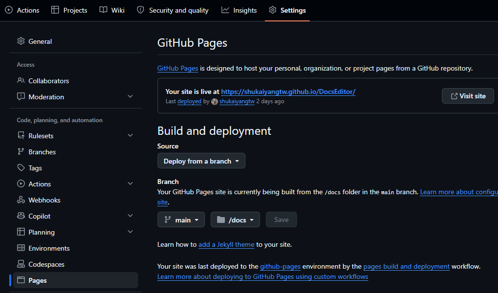

生成整個網站
--------

完成所有文件的編輯之後，只要點擊「產生HTML檔案」按鈕，所有的 *_zh.htm 檔案和 *_en.htm 檔案都會被生成在指定的目錄裡。

使用者可以繼續編輯這些 .htm 和 .css 檔案，以加上更多細節的樣式，甚至加入 JavaScript 程式碼。要發布這個網站的時候，不需要 docs.tocx 和 .md 檔案。

發佈到 GitHub Pages
----------------

如果要以本軟體製作 GitHub 某個儲存庫(repository)的線上文件，在該儲存庫下建立名為 docs 的子目錄，並將產生的網站檔案都上傳到該目錄下，
然後在該儲存庫的 Settings 下選擇 Pages 項目下，Build and deployment 處選擇網頁來源的 Branch 為 main / docs 並按下 Save 按鈕儲存此設定，
如下圖所示，那麼這個網站就會出現在網址 https://你的名字.github.io/儲存庫名稱/ 裡。

