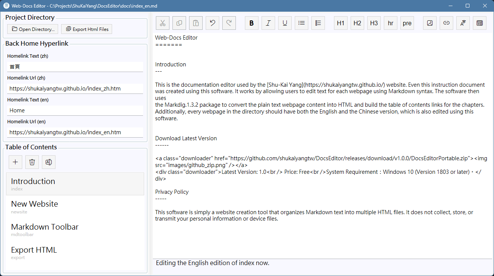

Web-Docs Editor
=======

Introduction
---

This is the documentation editor used by the [Shu-Kai Yang](https://shukaiyangtw.github.io/) website. Even this instruction document
was created using this software. It works by allowing users to edit text for each webpage using Markdown syntax. The software then uses
the [Markdig.1.4.2](https://github.com/xoofx/markdig) package to convert the plain text webpage content into HTML and build the table 
of contents links for the chapters. Additionally, every webpage in the directory should have both the English and the Chinese version,
 which is also edited using this software.

As shown  above, the user creates or selects the page to be edited in the chapter directory on the left, and edits the page content in the text 
editing area on the right by Markdown syntax (or mixed with HTML syntax). The user can also use the toolbar to insert Markdown syntax into
the content, use the language switch button in the top-right corner to toggle between Chinese and English versions, or preview the current
results in a web browser.

Download Latest Version
------

Latest Version: 1.0  Price: Free System Requirement：Windows 10 (Version 1803 or later)。

Privacy Policy
-----

This software is simply a website creation tool that organizes Markdown text into multiple HTML files. It does not collect, store, or transmit your personal information or device files.