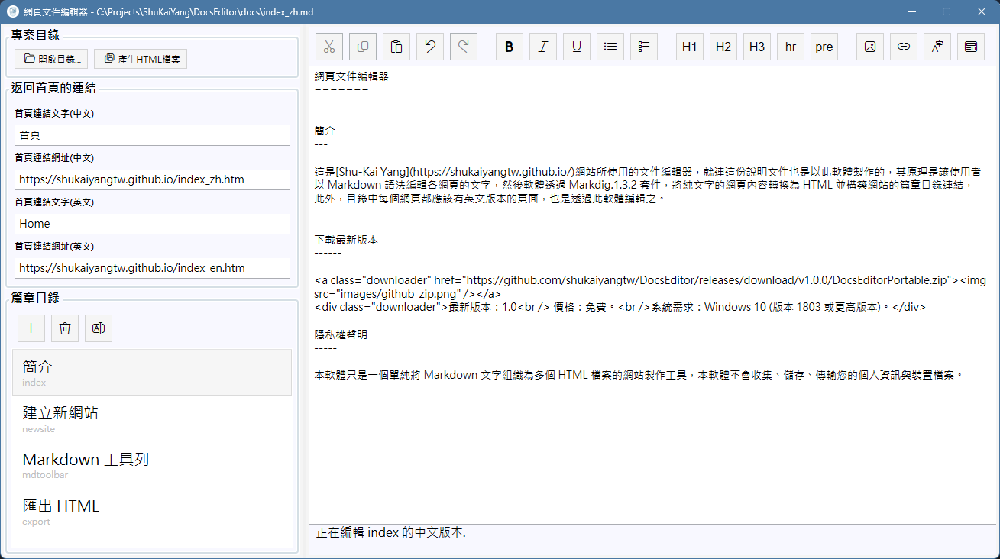

網頁文件編輯器
=======

簡介
---

這是[Shu-Kai Yang](https://shukaiyangtw.github.io/)網站所使用的文件編輯器，就連這份說明文件也是以此軟體製作的，其原理是讓使用者
以 Markdown 語法編輯各網頁的文字，然後軟體透過 [Markdig.1.4.2](https://github.com/xoofx/markdig) 套件，將純文字的網頁內容轉換為
HTML 並構築網站的篇章目錄連結，此外，目錄中每個網頁都應該有英文版本的頁面，也是透過此軟體編輯之。

如上圖所示，使用者在左邊的篇章目錄中建立或選擇目前要編輯的頁面，在右邊的文字編輯區以 Markdown 語法(可混和  HTML 語法)編輯該頁
的內容，利用上方的工具列可以在文章中插入 Markdown 語法，並利用右上角語言切換按鈕切換中英文版本，或在網頁瀏覽器中預覽目前編輯
的效果。

下載最新版本
------

最新版本：1.0  價格：免費。 系統需求：Windows 10 (版本 1803 或更高版本)。

隱私權聲明
-----

本軟體只是一個單純將 Markdown 文字組織為多個 HTML 檔案的網站製作工具，本軟體不會收集、儲存、傳輸您的個人資訊與裝置檔案。