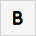
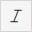
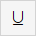
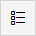
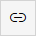
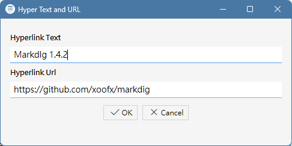

What is Markdown syntax?
------------------------

As is well known, HTML is a generic markup language that can add rich styling, formatting, images, and hyperlinks to plain text, and can
be read across platforms and software on various devices. However, if document authors have to manually insert HTML tags into their articles,
it significantly reduces writing efficiency and readability of the text files. In other words, it is simply a hassle!

Isn't there a compromise between minimalist plain text and tedious HTML document editing? If document authors do not need complex effects
and only require some intuitive formatting —such as displaying document titles, paragraphs, and bullet points— that is where Markdown syntax comes in. 
Markdown files are plain text documents, typically with a '.md' extension. Using simple symbols like brackets or hash signs, you can quickly apply
formatting to specific text. Furthermore, many document publishing platforms now support Markdown syntax, such as GitHub and HackMD,
as well as various AI LLMs, all of which can quickly understand Markdown documents and display them correctly.

For a table of Markdown syntax, please refer to [Markdown: Syntax](https://daringfireball.net/projects/markdown/syntax). If you are not familiar
with the syntax, the toolbar above allows you to quickly insert Markdown syntax into your editing that is equivalent to the following HTML tags.

Add Text Styles
------

In Markdown syntax, simply adding an * or + to some text can change it to bold, italic, or other styles. The user can type the symbols directly 
or use the mouse to select the text, then click the toolbar button to add the following styles.

| Button  | Markdow syntax | Equivalent HTML tag |
| :----: | :----: | :----: | 
|  | \*\*bold\*\* | &lt;b&gt;bold&lt;/b&gt; |
|  | \*italic\* | &lt;i&gt;italic&lt;/i&gt; |
|  | \+\+underline\+\+ | &lt;u&gt;underline&lt;/u&gt; |

If you want to create an ordered list or a unordered list, just type the items line by line.
After selecting the lines, click the toolbar buttons to convert the lines into list items.

 Markdown syntax for equivalent  &lt;ul&gt; tag:

\- Item 1

\- Item 2

\- Item 3

 Markdown syntax for equivalent  &lt;ol&gt; tag:

1 Item 1

2 Item 2

3 Item 3

Since symbols like * or + and various parentheses may be recognized as Markdown syntax, and may be converted into HTML tags by this software,
if the user wants these symbols displayed ordinarily, just adds a backslash "\" before the symbols.

Add Titles and Dividers
------

The Makedig package automatically wraps continuous text lines into a paragraph with a &lt;p&gt; tag. Additionally, when forming the h1~h4 header hierarchy in the document, 
just add 1~4 symbol # before the title text line, or after selecting the text line, click the H1~H3 buttons on the toolbar.

Additionally, if you want to add a separator line like the &lt;hr/&gt; tag between text lines, click the hr button on the toolbar.

If you want a part of text displayed exactly as is, without interpreting it as Markdown or HTML syntax, select the text and click the pre button on the toolbar.
The effect is the same: Add &lt;pre&gt; or &lt;code&gt; tags before or after text, which is suitable for displaying source code in documents.

Insert Images and Hyperlinks
--------

Compared to plain text, the advantage of HTML is that they can provide images and hyperlinks within documents. Although Markdown documents are plain text,
they still cite external images in files similar with &lt;img&gt; elements in HTML, with the following syntax:

\!\[Alternative text\]\(Image file path\)

The user doesn't need to memorize this syntax. He simply clicks the image button on the toolbar and selects the image to insert in the file dialog.
The software will insert the Markdown syntax and image path into the text being edited.

The Markdown syntax for inserting hyperlinks in documents is similar, except it lacks an exclamation mark:

\[Hyperlink text\]\(Hyper url\)

Similarly,  the user doesn't need to memorize this syntax. He simply clicks the hyperlink button on the toolbar and enters the link text and URL in the following dialog box.

