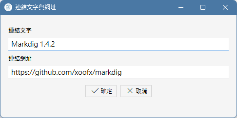

什麼是 Markdown 語法？
----------------

眾所周知地，HTML 是一種通用的標記語言，可以給平淡無奇的純文字稿加上豐富的樣式、排版、插入圖片和超連結，並且跨平台、跨軟體地
可以在各種裝置上被閱讀，然而，如果讓文件作者手動地在自己的文章中穿插這些 HTML 標記，不但會大幅降低文件的編寫效率，而且文件原
始檔案的可讀性非常差，總結來說就是兩個字：麻煩！

難道不能在極簡的純文字跟麻煩的 HTML 文件編纂當中取個折衷嗎？如果作者不需要複雜的圖文效果，只需要在純文字稿件加註一些直覺的格式
就夠了，例如顯示文件的標題、段落、條列就夠了，於是有了 Markdown 語法，Markdown 文件是純文字檔案，副檔名通常是 .md。可以透過
簡單的符號、例如跨號、井字號等等，快速地給某段文字加上格式設定，而且現在有許多文件發布平台都支援 Markdown 語法，例如 GitHub 和
HackMD，以及一些 AI 大語言模型，它們都能夠快速地理解 Markdown 文件並正確地顯示。

如果需要 Markdown 語法表，請參考 [Markdown 線上文件](https://markdown.tw/)，如果不熟悉語法也沒關係，上面的工具列可以讓你快速地
在編輯當中插入等效於以下 HTML 標籤的 Markdown 語法。

加上文字樣式
------

在 Markdown 語法當中，只要在文字前後加上 * 或 + 就可以把這段文字變成粗體或斜體等等樣式，使用者可以直接在編輯中鍵入，或是用滑鼠
選取文字以後，再點擊工具列按鈕來加上以下的樣式。

| 按鈕 | Markdow語法 | 等效HTML標籤 |
| :----: | :----: | :----: | 
|  | \*\*粗體\*\* | &lt;b&gt;粗體&lt;/b&gt; |
|  | \*斜體\* | &lt;i&gt;粗體&lt;/i&gt; |
|  | \+\+底線\+\+ | &lt;u&gt;底線&lt;/u&gt; |

如果要建立有數字或沒數字的條列，只要逐行鍵入條列的文字，選取多行文字之後，點擊以下工具列按鈕，就會逐行地變成條列。

 等效 &lt;ul&gt; 標籤的 Markdown 語法:

\- 第一項

\- 第二項

\- 第三項

 等效 &lt;ol&gt; 標籤的 Markdown 語法:

1 第一項

2 第二項

3 第三項

既然 * 或 + 以及各種括弧這些符號會讓部分文字被辨識為 Markdown 語法，並且被本軟體轉換為 HTML 標籤，那如果使用者在文字中就是要
使用這些符號的時候，為了避免程式誤判，可以在符號前加上反斜線「\」符號，以告知軟體忠實呈現這些符號的原貌。

加入標題與分隔線
------

本軟體使用的 Makedig 套件會自動地將文件中、連續的文字行以一個 &lt;p&gt; 標籤包裹為一個段落，此外，在要在文件中形成 h1～h4 的標題階層，
可以在標題文字行之前加入 1～4 個 # 字號，或是選取該行文字以後，點擊工具列上的 H1～H3 按鈕。

除此之外，如果要在文字行間加入如同 &lt;hr /&gt; 標籤的分隔行，點擊工具列上的 hr 按鈕。

如果想要讓某一段文字完全以原樣呈現，不解讀為 Markdown 語法或  HTML 語法，選取該段文字以後，點擊工具列上的 pre 按鈕，其效果等於
在文字前後加上了 &lt;pre&gt; 或 &lt;code&gt; 標籤，這個功能適合用來在文件中展示原始程式碼。

插入圖片與超連結
--------

相較於純文字，HTML 網頁的優點就在於可以在文件中提供圖片與超連結，雖然 Markdown 文件是純文字，不能內嵌圖片檔案，但仍然提供了類似
&lt;img&gt; 標籤的語法，在文件中引用外部圖片，語法如下:

\!\[替代文字\]\(圖片路徑\)

使用者不必去記憶這個語法，只要點擊工具列上的圖片按鈕，使用檔案對話框去選取要插入的圖片，軟體就會在目前編輯的文字中插入 Markdown 語法與圖片路徑。

在文件中插入超連結的 Markdown 語法也很類似，只不過少了一個驚嘆號:

\[連結文字\]\(連結網址\)

同樣地，使用者也不必記憶這個語法，只要點擊工具列上的這個超連結按鈕，並且在以下的對話框中輸入連結文字和連結網址即可。

