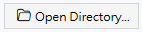
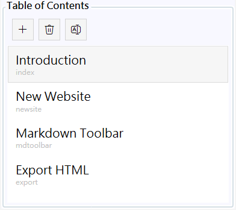
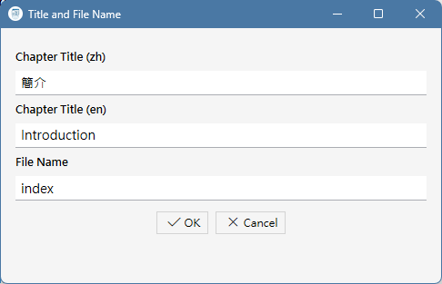
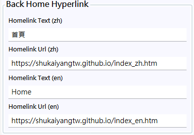

Create a Website in the Specified Directory
-------------------------------------------

The user clicks the "Open Directory" button in the upper left corner, select the directory to create the new website. The software copies
the built-in website template files into it, including RWD CSS files, icons, and background image files, and create a docs.tocx file to handle the
table of contents of the website. After that, the user can start editing the content; This software does not have a "Save" button,
It automatically saves the user's edits at any time.

During editing, you can click the "Switch Language" button in the upper right corner to switch between Chinese and English editions,
or click the "Preview" button to show the generated page in your browser. After the software closes, it automatically remembers the current directory you are editing.
Next time you open the software, it continues editing the same website. If you want to switch between multiple editing sites, Similarly, 
use 'Open Directory' to select another website directory. This software will read the docs.tocx file in that directory to load the website's content.

Manage the Table of Contents
--------

A website may not have only one webpage. As a web document editor, this software provides the table of contents shown below, where each chapter 
generates a Chinese and English version of the webpage. For example, this software will first generate a page named index by default, then generate index_zh.htm
and index_en.htm based on it. In index.html, there is JavaScript code that chooses to jump to one of them based on the reader's browser language.

In this user-interface, users can click the "+" button to add a new chapter. The following dialog box will appear. Enter the Chinese and English titles and file name of the new chapter.
Existing chapters can also be renamed using "A|" button.  Additionally, dragging chapters directly in the table of contents can change the order of them.

This software automatically saves the content of each chapter as .md files. For example, chapter content with the file name "index" will be saved
as index_zh.md and index_en.md, and to generate  index_zh.htm and index_en.htm of the website, and links to each other are provided on the webpages.

Edit the Back Hyperlink
-------

The purpose of this software is to edit and generate web document websites. A generated site may be used as a complete document site or as part of a some website.
It which determines where the "Back Home" button in the upper left corner of the site should goes. This software can set the text and Chinese and English URLs displayed
by the "Back Home" button in the user-interface shown below. You may replace the icon by replacing the back.png in the  images directory.

