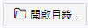
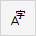
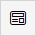
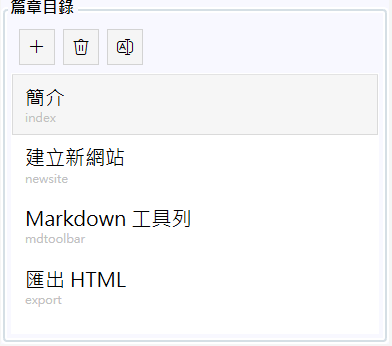
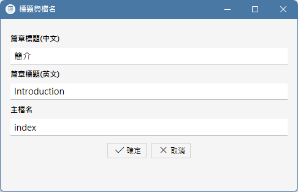
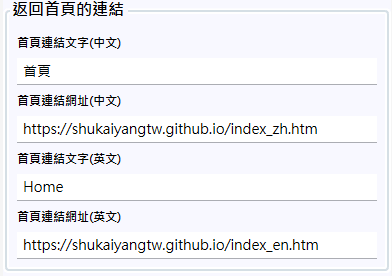

指定目錄建立新網站
---------

使用者只要點擊左上角的「開啟目錄」按鈕，選擇要建立新網站的目錄，本軟體就會將內建的網站範本，包括  RWD 的 CSS 檔案，圖示和背景圖檔，
都複製到該目錄，並建立一個紀錄網站目錄的 docs.tocx 檔案，接下來使用者就可以開始編輯網頁內容；本軟體並沒有「儲存」按鈕，
它隨時自動儲存使用者所編輯的內容。

在編輯當中，隨時可以點擊右上角的「切換語言」按鈕來切換中英版本，也可以點擊「預覽」按鈕在網頁瀏覽器中查看目前編輯中的內容被生成網頁的樣子。
在軟體關閉以後，它會自動記憶目前編輯中的網站目錄，下一次再開啟的時候會繼續編輯同一個網站。如果想要在多個編輯中的網站之間切換，
同樣用「開啟目錄」去選擇網站目錄即可，本軟體會讀取該目錄下的 docs.tocx 檔案來載入該網站的內容。

管理網站篇章目錄
--------

一個網站當然不會只有一個網頁，作為網頁文件的編輯器，本軟體提供了如下圖的篇章目錄，其中每一個篇章都各會生成一個中英文版本的網頁，
本軟體會預設先產生一個名為 index 的頁面，並且根據它生成 index_zh.htm 和 index_en.htm，在 index.html 的 JavaScript
程式碼會根據讀者的瀏覽器語言選擇跳往其中之一，這就是新網站的起點。

在這個介面，使用者可以點擊「+」按鈕新增篇章，將會出現如下的對話框，在此輸入新篇章的中英文標題與主檔名，既有的篇章也可藉由「A|」按鈕修改之，
此外，直接在上圖的清單中拖曳，可以改變篇章的順序。

本軟體會自動地將每一個篇章的內容儲存為 .md 檔案，例如主檔名為 index 的篇章內容將會儲存為 index_zh.md 和 index_en.md，在生成網站的 HTML
檔案的時候，也會生成 index_zh.htm 和 index_en.htm 檔案，並在網頁中提供彼此切換的連結。

返回首頁的連結
-------

本軟體的功用在於編輯與生成制式的網頁文件網站，該網站可能被作為一個完整的文件網站，或是作為某個網站的一部分作使用，這會決定網站左上角的「返回首頁」
圖示與文字應該前往哪裡，所以本軟體可以在下圖的介面中設定「返回首頁」按鈕應該顯示的文字與中英文網址，圖示請自行替換 images 目錄下的 back.png 圖檔。

